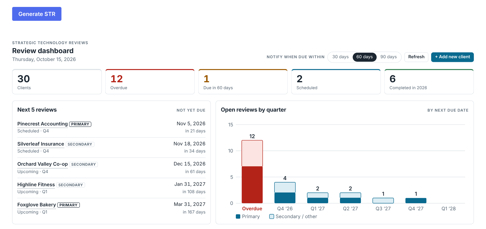

# MSP QBR toolkit



*Fictional client names.*

Tools an MSP can use to build client Quarterly Business Reviews (Strategic Technology Reviews) from **HaloPSA** and **N-able N-sight**:

| Folder | What it is |
|---|---|
| `server.py`, `setup.ps1` | Read-only **Halo MCP server** for Claude desktop: tickets, SLA, assets, contracts, licences, recurring invoices |
| `nsight-mcp/` | Read-only **N-sight MCP server**: clients, sites, workstations, servers, hardware inventory |
| `str-generator/` | Stand-alone **STR generator**: fills the Word template and builds portrait and landscape PDFs, with an optional SharePoint "Generate STR" button |
| `skill/SKILL.md` | A **Claude skill** that builds a QBR slide deck and the filled Word review using the two MCP servers |
| `templates/` | The Word Strategic Technology Review template |
| `sharepoint-dashboard/` | **QBR Dashboard** SharePoint web part: who's overdue, who to schedule next, copy-ready scheduling emails, on a SharePoint list. Includes the list setup script and a no-Node package builder |

Everything is read-only against Halo and N-sight. No credentials are stored in files: the setup scripts put the Halo client secret, N-sight API key and Graph app secret in Windows Credential Manager (via `keyring`).

## Quick start (Windows)

1. **Halo MCP:** create a Halo API application (Client ID and Secret, Agent login, read-only permissions; see the setup notes below), then run:
   `powershell -ExecutionPolicy Bypass -File .\setup.ps1`
2. **N-sight MCP:** generate an N-sight API key, then run:
   `powershell -ExecutionPolicy Bypass -File .\nsight-mcp\setup.ps1`
3. Merge the printed config into Claude desktop (Settings > Developer > Edit Config). `claude_config_snippet.example.json` shows the shape. Then fully quit and reopen Claude.
4. **Skill (optional):** add `skill/SKILL.md` as a skill in Claude, and set the reference-deck link and install path in it.
5. **QBR Dashboard (optional):** see `sharepoint-dashboard/README.md`.
6. **STR generator (optional):** see `str-generator/README.md`. Copy `str-generator/config.example.json` to `config.json` and fill in your Entra app and SharePoint details.

## Customising for your MSP

Nothing is branded out of the box. Copy `str-generator/config.example.json` to `str-generator/config.json` and set:
- `branding`: company name, support phone and email, helpdesk portal URL, review link (optional), logo file (PNG, replaces the "YOUR LOGO" placeholder in the Word template) and extra local admin account names to hide in the PC table.
- `services`: your Halo **service IDs** for support plans, backup and other subscriptions. Every Halo instance has different IDs; the Halo MCP tool `list_client_services` shows them.
- `graph`: your Entra app and SharePoint site, if you use the SharePoint button.

The Word template uses `{{COMPANY}}`, `{{PHONE}}`, `{{EMAIL}}`, `{{HELPDESK_URL}}` and `{{REVIEW_URL}}` tokens, which the generator fills from `branding`. You can also edit the template directly.

Other things you may want to tune in `str_generator.py`: `MODELS` (Lenovo model codes), `CPU_RELEASE`, the slide colours in `CSS`, and the security wording (it assumes Huntress + Defender).

## Never commit

`.gitignore` excludes these, but check before pushing:
- `claude_config_snippet.json` and `config.json`: your tenant and app IDs.
- Your logo, if you would rather not publish it.
- `str-generator/output/`, logs, CSV, XLSX and JSON exports: client data.

## Setup notes

See `nsight-mcp/README.md`, `str-generator/README.md` and `str-generator/CHANGELOG.md` (how each report field is sourced).

---

## Halo MCP server (read-only)

Gives Claude desktop read-only access to Halo PSA for QBRs and ticket triage review.

### Setup
1. In Halo, create the API application (Configuration > Integrations > HaloPSA API > View Applications > New):
   - Authentication: **Client ID and Secret (Services)**, Login type **Agent** (a dedicated API agent)
   - Permissions: `read:tickets`, `read:customers`, `read:assets`, `read:contracts`, `read:invoices`, `read:reporting`, `read:kb`
2. Install Python 3.10+ if needed (python.org, tick "Add to PATH").
3. In this folder run:
   ```
   powershell -ExecutionPolicy Bypass -File .\setup.ps1
   ```
   It creates a virtual environment, stores the Client Secret in Windows Credential Manager, tests the connection and prints the Claude config entry.
4. Claude desktop > Settings > Developer > Edit Config, merge in the `halo` entry, then fully quit and reopen Claude.

### Tools
| Tool | Use |
|---|---|
| `test_connection` | Check credentials |
| `list_clients`, `get_client` | Find a client ID |
| `ticket_summary` | QBR metrics: volume, monthly trend, breakdowns, resolution times, SLA % (`quarter="2026-Q3"`) |
| `search_tickets`, `get_ticket` | Ticket lists and full detail with actions |
| `new_tickets` | Recent tickets with descriptions, for triage suggestions |
| `list_assets` | Devices with warranty/purchase fields |
| `list_contracts` | Client agreements |
| `run_report` | Run a saved Halo report by ID |

### Notes
- Nothing writes to Halo. Triage write-back (`edit:tickets`) can be added later as a separate API app.
- Halo field names vary by version; if a metric comes back empty, run `.venv\Scripts\python.exe server.py --test` and check the sample ticket fields.
- To change the secret: `.venv\Scripts\python.exe -m keyring set halo-mcp halo_client_secret`
- Logs go to Claude desktop's MCP log (Settings > Developer).
