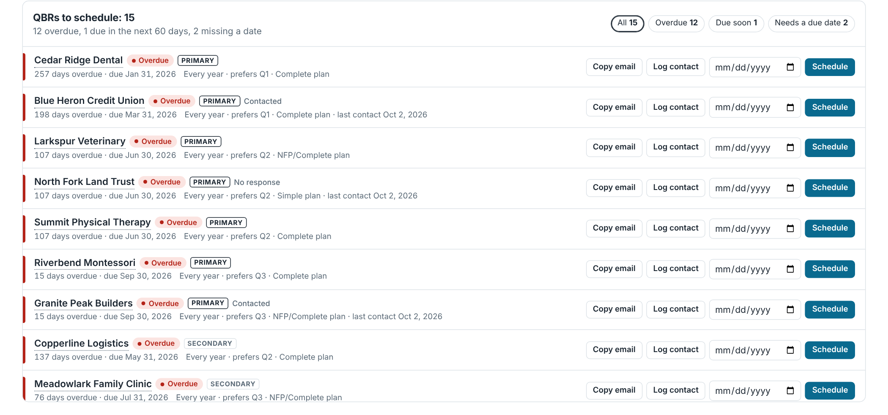
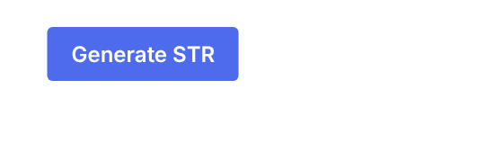

# QBR Dashboard (SharePoint web part)

A SharePoint Online web part that tracks when each client's Strategic Technology Review (QBR) is due and tells you who to schedule next. It reads and writes a plain SharePoint list (**QBR Tracker**), so the data stays in your tenant and anyone with edit rights on the list can use it.




*Screenshots use fictional client names.*

## What it does
- **KPI tiles:** clients, overdue, due within the notice window, scheduled, completed this year.
- **Next 5 reviews** that aren't due yet, and an **open reviews by quarter** chart (primary vs secondary clients).
- **QBRs to schedule** queue: overdue, due soon (30 / 60 / 90 day window, remembered per browser), scheduled meetings that need confirming, and clients with no due date. Each row has:
  - **Copy email** – a ready-to-send "time to schedule your review" email using the client's preferred quarter.
  - **Log contact** – sets Status to *Contacted* and Last contact to today.
  - **Schedule** – saves the meeting date and sets Status to *Scheduled*.
- Click a client name for a side panel with full details, **Mark completed** (rolls the next due date forward by the client's frequency into their preferred quarter) and **Reopen**.
- **+ Add new client** form.

## Generate STR button



The **Generate STR** button above the dashboard is a standard SharePoint **Button** web part. Its link points at the new-item form of the **STR Requests** list (`<site>/Lists/STR Requests/NewForm.aspx`), which the STR generator creates. Someone fills in Client, Quarter, Main contact and Review date. The generator service (see [`../str-generator`](../str-generator/README.md)) picks the request up within a minute and uploads the Word document and PDFs to the client's folder. `run.py --setup` prints the exact button link for your site.

## Install

1. **Create the list** on the site where the dashboard will live:
   ```powershell
   .\New-QbrTrackerList.ps1 -SiteUrl https://yourco.sharepoint.com/sites/Operations -ClientId <PnP app id>
   ```
   Or create it by hand using the columns below.
2. **Build the package** (Python 3, no Node or SPFx toolchain needed):
   ```
   python build_sppkg.py --company "Your MSP" --website https://yourmsp.example
   ```
   `--company` is used in the scheduling email. Use `--list` if your list has a different title.
3. **Deploy:** upload `qbr-dashboard.sppkg` to your tenant **App catalog** (SharePoint admin centre > More features > Apps), choose **Deploy**, then on the site go to **Site contents > New > App** and add **QBR Dashboard**.
4. **Add to a page:** edit a page, add the **QBR Dashboard** web part (Advanced group), and optionally a **Button** web part above it for Generate STR.

The package contains a single hand-written script (`qbr-dashboard.js`, no build step or dependencies beyond SharePoint's own `sp-webpart-base`). To change it, edit the file, bump `VERSION` in `build_sppkg.py`, rebuild and upload over the old package.

## QBR Tracker columns

| Display name | Internal name | Type | Notes |
|---|---|---|---|
| Client | `Title` | Single line of text | Required |
| Priority | `Priority` | Choice | Primary, Secondary, As Needed |
| Every (years) | `Frequency` | Number | 1 = yearly, 2 = every other year |
| Preferred window | `PreferredWindow` | Choice | Q1, Q2, Q3, Q4 |
| Status | `QBRStatus` | Choice | Open, Contacted, No response, Scheduled, Completed, Declined, As needed |
| Last completed | `LastCompleted` | Date | |
| Planned due | `PlannedDue` | Date | Normally the end of the preferred quarter |
| Scheduled date | `ScheduledDate` | Date | Set by **Schedule** |
| Manual due (override) | `ManualDue` | Date | Wins over everything else |
| Last contact | `LastContact` | Date | Set by **Log contact** |
| Plan | `Plan` | Single line of text | Support plan name, shown in the queue |
| Notes | `QBRNotes` | Multiple lines of text | |
| SharePoint folder | `SPFolder` | Single line of text | Link to the client's documents |
| Next due | `NextDue` | Calculated (date) | Formula in `New-QbrTrackerList.ps1`; the web part uses the same rule |

**Next due rule:** Manual due if set; otherwise the scheduled date; otherwise Planned due, rolled forward by *Every (years)* until it's after Last completed; otherwise Last completed + *Every (years)*.
